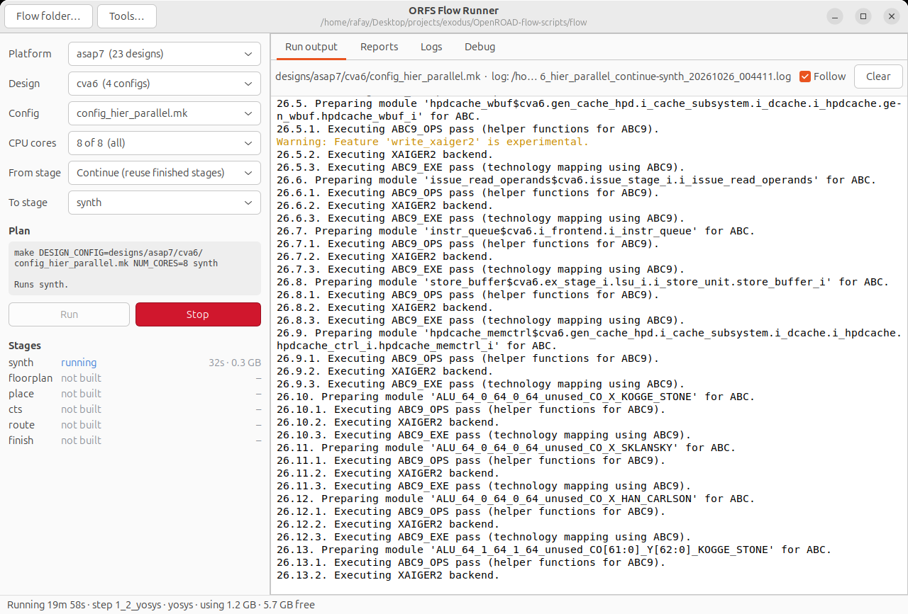

# CVA6 RTL-to-GDS on OpenROAD-flow-scripts (asap7)

Everything needed to run the CVA6 core through the ORFS flow on the asap7 platform, from a fresh clone.
The flow is vendored in `orfs/`, a trimmed copy of [OpenROAD-flow-scripts](https://github.com/The-OpenROAD-Project/OpenROAD-flow-scripts):
`Makefile`, `scripts/`, `util/`, `platforms/asap7` and `platforms/common`, plus the CVA6 design and sources.
Yosys comes as a git submodule in `yosys/`, on a branch whose `abc_new` pass runs ABC on several modules at once
(see [Parallel abc_new](#parallel-abc_new)). The OpenROAD binary is not included; Step 1 covers installing it.

Contents: [Requirements](#requirements) · [The CVA6 RTL](#the-cva6-rtl) · [Step by step](#step-by-step) · [GUI](#gui) · [What is configured](#what-is-configured) ·
[Parallel abc_new](#parallel-abc_new) · [Status](#status) · [Troubleshooting](#troubleshooting) · [Other files](#other-files) · [Licenses](#licenses)

## Requirements

These are the versions the flow was run with. Other versions may work but were not tried.

| Tool | Version used | Where to get it |
| --- | --- | --- |
| OpenROAD | `26Q4-271-g0907a8656e` | [OpenROAD](https://github.com/The-OpenROAD-Project/OpenROAD), or built by ORFS (Step 1) |
| Yosys | The `yosys/` submodule: [Pr0Chef/yosys](https://github.com/Pr0Chef/yosys/tree/abc-new-parallel) branch `abc-new-parallel` at `7b7e811cb`, which is upstream `0.69+274` (git `7513f8df8`) plus parallel `abc_new`. It builds with the `read_slang` frontend | Built from the submodule (Step 2). Stock Yosys `0.69+274` also runs the flow, with `abc_new` on one core. The slang frontend comes from [yosys-slang](https://github.com/povik/yosys-slang) |
| CMake, a C++17 compiler | any recent | your package manager; only to build the Yosys submodule |
| KLayout | `0.28.16`, only for the final GDS step | [klayout.de/build.html](https://www.klayout.de/build.html), or `apt` on Ubuntu |
| GNU Make, Python 3, Git | any recent | your package manager |
| `dpkg-deb` | any recent, only to build the GUI's `.deb` | part of `dpkg` on Debian and Ubuntu |
| Memory | 16 GB or more recommended | detailed routing peaks at about 7 GB |

Docs: [ORFS documentation](https://openroad-flow-scripts.readthedocs.io/en/latest/) ·
[CVA6 core](https://github.com/openhwgroup/cva6) · [asap7 PDK](https://github.com/The-OpenROAD-Project/asap7_pdk_r1p7).

## The CVA6 RTL

The RTL is in this repo, in `orfs/flow/designs/src/cva6/` (175 files, 169 of them SystemVerilog). It is ORFS's copy of
[CVA6](https://github.com/openhwgroup/cva6), taken from upstream commit `3a389af` "with some changes for the RAMs"
(from the `README.md` in that folder). No separate download is needed.

| Folder | Contents |
| --- | --- |
| `core/` | The pipeline: `cva6.sv` (top module `cva6`), `ex_stage.sv`, `issue_stage.sv`, `csr_regfile.sv`, `decoder.sv`, `multiplier.sv`, and others |
| `core/frontend/` | Fetch, branch prediction and instruction queue |
| `core/cache_subsystem/` | Instruction and data caches, including the `hpdcache` data cache |
| `core/cvfpu/` | Floating-point unit sources |
| `core/cva6_mmu/`, `core/pmp/` | Address translation and physical memory protection |
| `core/cvxif_example/` | Example of the CORE-V eXtension interface |
| `core/include/` | Packages and the configuration (`cv32a65x_config_pkg.sv`) |
| `vendor/pulp-platform/` | `axi`, `common_cells` and `tech_cells_generic` dependencies |
| `common/local/util/` | Local utilities, such as `sram_cache.sv` |

The design is built with the `cv32a65x` configuration (`core/include/cv32a65x_config_pkg.sv`): 32-bit (`XLEN` 32),
one commit port, 8 scoreboard entries, no floating-point extensions (`RVF` and `RVD` off), no MMU, 8 PMP entries,
the CORE-V extension interface enabled, a 2 KiB instruction cache and the write-through `hpdcache` data cache.
The clock port is `clk_i`.

The "changes for the RAMs" are in `hpdcache_sram.sv`, `hpdcache_sram_wbyteenable.sv` and `sram_cache.sv`. They
instantiate the `fakeram7_*` macros directly instead of generic SRAM models, which is why the asap7 platform's
macro LEF and liberty files are needed.

The file list the flow synthesizes is `VERILOG_FILES` in `orfs/flow/designs/asap7/cva6/config.mk`. The top module
is set by `DESIGN_NAME = cva6` in the same file.

## Step by step

### Step 1: install the tools

Skip this step if `openroad -version`, `yosys -V` and `klayout -v` already work.

Option A, build OpenROAD and Yosys with ORFS. These commands come from the ORFS scripts' options and were not
run as part of this repo; the first build takes a long time. See the
[ORFS build guide](https://openroad-flow-scripts.readthedocs.io/en/latest/user/BuildLocally.html) if a step fails.

```bash
git clone --recursive https://github.com/The-OpenROAD-Project/OpenROAD-flow-scripts
cd OpenROAD-flow-scripts
sudo ./setup.sh                 # installs system dependencies (Linux needs sudo)
./build_openroad.sh --local     # builds OpenROAD and Yosys into tools/install/
export PATH="$PWD/tools/install/OpenROAD/bin:$PWD/tools/install/yosys/bin:$PATH"
```

Option B, use tools you already have, as long as they are on your `PATH`.

Install KLayout. On Ubuntu 24.04 (this installed 0.28.16):

```bash
sudo apt install -y klayout
```

On other systems use the [KLayout download page](https://www.klayout.de/build.html).

Check the tools:

```bash
openroad -version
yosys -V
klayout -v
yosys -p "help read_slang" | head -5   # must print the read_slang help, not "No such command"
```

### Step 2: clone this repo and build Yosys

```bash
git clone --recurse-submodules git@github.com:Pr0Chef/RapidFlow.git
cd RapidFlow
```

The repo itself is about 430 MB; the Yosys submodule and its own submodules (ABC, slang and a few libraries) come
on top. Use `https://github.com/Pr0Chef/RapidFlow.git` if you do not have SSH access to GitHub. In a clone made
without `--recurse-submodules`, fetch them with:

```bash
git submodule update --init --recursive
```

Build Yosys from the submodule and point the flow at it. The tested build used CMake's defaults; the first build
takes a while:

```bash
cmake -S yosys -B yosys/build
cmake --build yosys/build -j"$(nproc)"
export YOSYS_EXE="$PWD/yosys/build/yosys"
"$YOSYS_EXE" -V                                       # should report git sha1 7b7e811cb
"$YOSYS_EXE" -p "help read_slang" | head -5           # must print the read_slang help
```

`yosys-abc` is built next to `yosys` in `yosys/build/`, which is where `abc_new` looks for it. `run_cva6_asap7.sh`
uses `$YOSYS_EXE` when it is set, and otherwise the `yosys` on your `PATH`. To use a Yosys you installed in Step 1
instead, leave `YOSYS_EXE` unset.

### Step 3: check your machine

```bash
nproc          # number of cores
free -g        # total and free memory
```

Detailed routing needs about 7 GB on top of what your desktop uses. On a 10.8 GB VM with a desktop session it was
killed twice by `systemd-oomd` (see [Troubleshooting](#troubleshooting)). Close heavy applications first, or run
without a desktop session.

### Step 4: run synthesis

```bash
./run_cva6_asap7.sh -H -c
```

`-H` selects hierarchical synthesis and `-c` cleans earlier results. Measured on this design with stock Yosys:
canonicalize takes about 95 seconds and the main synthesis about 2 hours (1 h 58 min), of which `abc_new` was
1,434 s. With the submodule's parallel `abc_new` that step is shorter; see [Parallel abc_new](#parallel-abc_new).
Watch progress from a second terminal:

```bash
tail -f orfs/flow/logs/asap7/cva6/hier/1_2_yosys.log
```

Outputs in `orfs/flow/results/asap7/cva6/hier/`: `1_2_yosys.v` (netlist) and `1_synth.odb`. The synthesis stats are in
`orfs/flow/reports/asap7/cva6/hier/synth_stat.txt`.

### Step 5: floorplan, placement, clock tree and routing

Each command reuses the stages already finished, so you can run them one at a time or jump straight to the last one.

```bash
./run_cva6_asap7.sh -H -s floorplan -j 4   # 2_floorplan.odb
./run_cva6_asap7.sh -H -s place -j 4       # 3_place.odb
./run_cva6_asap7.sh -H -s cts -j 4         # 4_cts.odb
./run_cva6_asap7.sh -H -s route -j 4       # 5_1_grt.odb, then 5_route.odb
```

`-j 4` limits OpenROAD to 4 threads, which lowers peak memory. Measured here: global routing took about 24 minutes.
The other stages were not timed. To go straight to the end, run only the `route` command: it runs the earlier stages first.

### Step 6: finish and write the GDS

```bash
./run_cva6_asap7.sh -H -s final -j 4
```

This writes the final reports and, through KLayout, `orfs/flow/results/asap7/cva6/hier/6_final.gds`. This step has not
been run to completion yet (see [Status](#status)). The platform has no GDS for the `fakeram7_*` SRAM macros, so
the macros are expected to come out as empty cells (`GDS_ALLOW_EMPTY ?= fakeram.*` in `platforms/asap7/config.mk`).

### Step 7: look at the results

Open the layout of a finished stage in the OpenROAD GUI (`gui_route` and `gui_final` work once those stages have been built). The script sets `OPENROAD_EXE` and `YOSYS_EXE` itself; for
a direct `make` call you set them first:

```bash
export OPENROAD_EXE=$(command -v openroad) YOSYS_EXE=$(command -v yosys)
cd orfs/flow
make DESIGN_CONFIG=designs/asap7/cva6/config_hier.mk gui_place   # or gui_floorplan, gui_cts
```

To render a layout picture without a display (used for the PDF), run from the repo root:

```bash
QT_QPA_PLATFORM=offscreen openroad -gui -no_splash -exit report_assets/snap_place.tcl
```

Quality-of-results numbers are in JSON per stage (instance count, area, utilization, slack, power):

```bash
cat orfs/flow/logs/asap7/cva6/hier/3_5_place_dp.json | python3 -m json.tool | grep -E "instance__count|timing__setup__ws|power__total"
```

Reports are in `orfs/flow/reports/asap7/cva6/hier/` (for example `3_detailed_place.rpt`).

### Running unattended

The script prints to the terminal and writes a timestamped log to `run_logs/`. For a long run that should survive
closing the terminal, start it as its own systemd user unit (Linux with systemd):

```bash
systemd-run --user --unit=cva6-route --collect --setenv=PATH="$PATH" \
  --working-directory="$PWD" ./run_cva6_asap7.sh -H -s final -j 4
systemctl --user status cva6-route     # is it running
journalctl --user -u cva6-route -f     # follow its output
```

This keeps it out of your desktop app's process group. It does not protect against the whole desktop session
being torn down under memory pressure.

## GUI

### Desktop app: ORFS Flow Runner

`gui/orfs_app.py` is a desktop application (GTK 3) that can run any design in the ORFS flow directory, not
only CVA6. Install it as a Debian package, which adds it to the app menu, or run it straight from the checkout.
Step-by-step instructions are in [gui/README.md](gui/README.md#install), and the illustrated user guide with
screenshots of real CVA6 runs is [docs/ORFS_Flow_Runner_user_guide.pdf](docs/ORFS_Flow_Runner_user_guide.pdf).



```bash
gui/packaging/build_deb.sh                           # builds dist/orfs-flow-runner_<version>_all.deb
sudo apt install ./dist/orfs-flow-runner_1.0.1_all.deb   # installs under /opt, with its dependencies
orfs-flow-runner                                     # or start ORFS Flow Runner from the app menu
python3 gui/orfs_app.py --flow /path/to/OpenROAD-flow-scripts/flow   # without installing
```

OpenROAD, Yosys and ORFS are installed separately; if the app doesn't find them, choose them with **Tools…**.

The left panel has drop-down menus for everything a run needs:

| Menu | Choices |
| --- | --- |
| Platform | every folder in `flow/designs/`; platforms whose PDK is not in `flow/platforms/` are greyed out |
| Design, Config | the designs of that platform and their `config*.mk` files (for example `config_hier.mk`) |
| CPU cores | 1 to the number of cores, passed as `NUM_CORES` |
| From stage | "Continue" (reuse finished stages), or re-run from synth, floorplan, place, cts, route or finish |
| To stage | synth, floorplan, place, cts, route or finish |

The plan box shows the exact `make` commands and what they will delete before you press Run. Re-running from a
stage runs `make clean_<stage>` for that stage and every later one, then `make <to-stage>`; you are asked to
confirm first. The stage list shows each stage as done, running, interrupted or not built, with its runtime and
peak memory. Every run is logged to `~/.local/share/orfs-flow-runner/run_logs/`.

The tabs on the right:

- **Run output**: the live output of the run, errors in red and warnings in amber.
- **Reports**: *QoR checks* (setup and hold slack, slew, cap and fanout violations, DRC, antenna, flow errors,
  final GDS, then all metrics by stage) and *Report files* (the design's `reports/` folder, with a line filter).
- **Logs**: stage logs and run logs, with a filter, an errors-and-warnings-only view, and follow mode for a log
  that is being written.
- **Debug**: tool versions and paths (including whether Yosys has `read_slang`), CPU and memory, the resolved make
  variables for the selected config, a count of every `[ERROR]`/`[WARNING]` message ID in the logs
  (double-click one to see it in Logs), a `make -n` dry run, and buttons to open a stage in the OpenROAD GUI,
  open the results folder, or copy the command.

### Web console (CVA6 only)

`gui/flow_gui.py` is a local web interface for the same flow. It needs only Python 3 (standard library):

```bash
python3 gui/flow_gui.py                      # uses $ORFS_FLOW, else orfs/flow
python3 gui/flow_gui.py --flow /path/to/OpenROAD-flow-scripts/flow --port 8765
```

Then open <http://127.0.0.1:8765/>. It has four tabs:

- **Run**: pick the variant, last stage, threads and clean, then Run or Stop. It calls `run_cva6_asap7.sh`, so
  finished stages are reused and the log still goes to `run_logs/`. Stage cards show done, running, interrupted or
  pending, with each step's runtime and peak memory read from the step logs. A run started outside the GUI (for
  example with `systemd-run`) is detected and reported.
- **Checks**: setup and hold slack, DRV (slew, cap, fanout), DRC, antenna and flow-error counts, read from each stage's
  metrics JSON, with failures in red. It also shows the Yosys check count, the detailed-route DRC report and whether
  the final GDS exists.
- **Reports & logs**: browse `reports/`, the stage logs and `run_logs/`, with a line filter and an errors-only view.
- **Layout**: render any finished `.odb` to PNG with OpenROAD offscreen (cached in `gui/.cache/`), or open it in the
  OpenROAD GUI (`make gui_<stage>`, needs a display).

One job runs at a time: a flow run or a render. The server listens on localhost only and can start and stop
runs, so do not bind it to a public address with `--host`.

## What is configured

- `orfs/flow/designs/asap7/cva6/config.mk`: stock ORFS CVA6 config (slang frontend, `fakeram7_*` SRAM macros).
- `orfs/flow/designs/asap7/cva6/config_hier.mk`: hierarchical variant. Keeps modules above 10000 gate
  equivalents, writes to the `hier` results directory, and uses the relaxed clock below.
- `orfs/flow/designs/asap7/cva6/constraint_hier.sdc`: copy of the stock SDC with `clk_period` 5000 instead of 910.
  At 910 the floorplan timing repair started at a worst slack of -3,330 ps and made little progress. Placement
  slack at 5000 is about +3,300 ps, so a period near 2 ns looks reachable but is untested.
- `run_cva6_asap7.sh`: options `-H` hierarchical, `-s STAGE` last stage (`synth`, `floorplan`, `place`, `cts`,
  `route`, `final`), `-c` clean first, `-j N` threads. Set `ORFS_FLOW` to use a different ORFS checkout, and
  `YOSYS_EXE` / `OPENROAD_EXE` to pick the tool binaries.
- `yosys/`: the Yosys submodule with parallel `abc_new` (next section).

## Parallel abc_new

CVA6's `config.mk` sets `SWAP_ARITH_OPERATORS = 1`, so ORFS maps the design with `abc_new` rather than `abc`.
Upstream `abc_new` maps one module at a time on a single core. The submodule's `abc_new` writes each module's ABC
input on the main thread, runs the `yosys-abc` processes on a thread pool, and reads the results back in a fixed
order, so the output does not depend on timing or on the number of threads above 1.

| Setting | Effect |
| --- | --- |
| `abc_new` (no option, as ORFS calls it) | Up to one ABC process per core |
| `abc_new -j <num>` | At most `<num>` ABC processes; `-j 1` is the original sequential loop |
| `YOSYS_MAX_THREADS=<num>` | Caps the default number of ABC processes |

Measured on the hierarchical CVA6 design (93 modules) by replaying only `abc_new` on a snapshot taken just before
it, on an 8-thread i5-1235U with 10 GB RAM:

| Run | `abc_new` wall time | Peak memory |
| --- | --- | --- |
| `-j 1` (sequential) | 2,052 s | 2,051 MB |
| `-j 8` | 1,398 to 1,730 s over three runs | about 1,610 MB |

The mapped cells match the sequential run in every module (818,111 cells), and `-j 4` and `-j 8` give byte-identical
netlists. The speedup is limited by serial Yosys work around ABC, chiefly whole-design buffer normalization in
`write_xaiger2` and `portarcs` (about 740 s). The design, the two bugs found on CVA6 and the open work are in
[docs/Parallel_abc_new_in_Yosys.pdf](docs/Parallel_abc_new_in_Yosys.pdf).

A full ORFS synthesis of hierarchical CVA6, run from the desktop app with each build in turn
(`config_hier_stock.mk` and `config_hier_parallel.mk`, `NUM_CORES=8`), gives:

| Build | Whole synthesis | `1_2_yosys` step | `abc_new` |
| --- | --- | --- | --- |
| Stock Yosys 0.69+274 | 47 min 55 s | 2,771 s | 1,496 s |
| Submodule 0.69+280, parallel `abc_new` | 39 min 9 s | 2,291 s | 1,150 s |

The two netlists are identical apart from the Yosys version comment. The method and charts are in section 7 of
[docs/ORFS_Flow_Runner_user_guide.pdf](docs/ORFS_Flow_Runner_user_guide.pdf). A run through to GDS with this build has
not been done yet.

## Status

Measured on the hierarchical flow: synthesis took 1 h 58 min (115,493 instances including 8 SRAM macros,
18,297 µm²). Floorplan, placement, clock tree synthesis and global routing finished, with no setup or hold
violations; global routing reports 132 max-slew violations that have not been examined. Detailed routing was
interrupted by memory pressure and has not finished, so no `6_final.gds` exists yet.

## Troubleshooting

- **`make` fails at once with error 127 and a path under `tools/install/`.** ORFS cannot find OpenROAD. Use the
  wrapper script, or export `OPENROAD_EXE` and `YOSYS_EXE` as in Step 7.
- **A stage stops with no error, mid-routing.** Look for memory pressure:
  `journalctl --since "1 hour ago" | grep -iE "oomd|oom-kill"`. Free memory, add RAM, or run without a desktop session.
- **`read_slang` is not found.** Your Yosys lacks the slang frontend. Build Yosys from the submodule (Step 2),
  making sure `git submodule update --init --recursive` fetched `yosys/libs/slang`, or build it through ORFS (Step 1, Option A).
- **`yosys/` is empty.** The clone was made without submodules. Run `git submodule update --init --recursive`.
- **Timing repair runs for hours during floorplan.** The clock is too tight for the netlist. Use `config_hier.mk`
  (5000 ps) rather than the stock `config.mk`.
- **Rerun from scratch.** Add `-c`, for example `./run_cva6_asap7.sh -H -c -s place`.

## Other files

- `CVA6_asap7_synthesis_log.pdf`: write-up of the work, the results and the problems hit.
- `docs/Parallel_abc_new_in_Yosys.pdf`: change report for the parallel `abc_new` work.
- `docs/ORFS_Flow_Runner_user_guide.pdf`: illustrated user guide for the desktop app, with a stock against parallel
  `abc_new` synthesis run of CVA6; `docs/images/gui/` holds the screenshots and chart used in the READMEs.
- `orfs/flow/designs/asap7/cva6/config_hier_stock.mk`, `config_hier_parallel.mk`: the configs of that A/B run
  (same as `config_hier.mk`, separate `FLOW_VARIANT`).
- `report_assets/`: placement layout image and the script that renders it.
- `gui/packaging/`: builds the ORFS Flow Runner `.deb` (`build_deb.sh`) with its menu entry and icon.
- `orfs_overlay/designs/sky130hd/cva6/`: an unfinished sky130hd attempt (slang frontend, flop-based RAM
  stand-ins). It needs the sky130hd platform from a full ORFS checkout and never completed.

## Licenses

`orfs/` contains files from OpenROAD-flow-scripts (see `orfs/LICENSE_BUILD_RUN_SCRIPTS`) and the CVA6 sources with
their vendored dependencies. The CVA6 sources are copied without their upstream license files, so check the
[CVA6 repository's](https://github.com/openhwgroup/cva6) license before reusing them.
