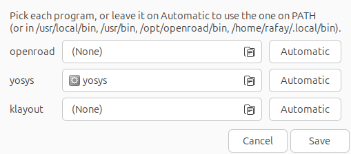
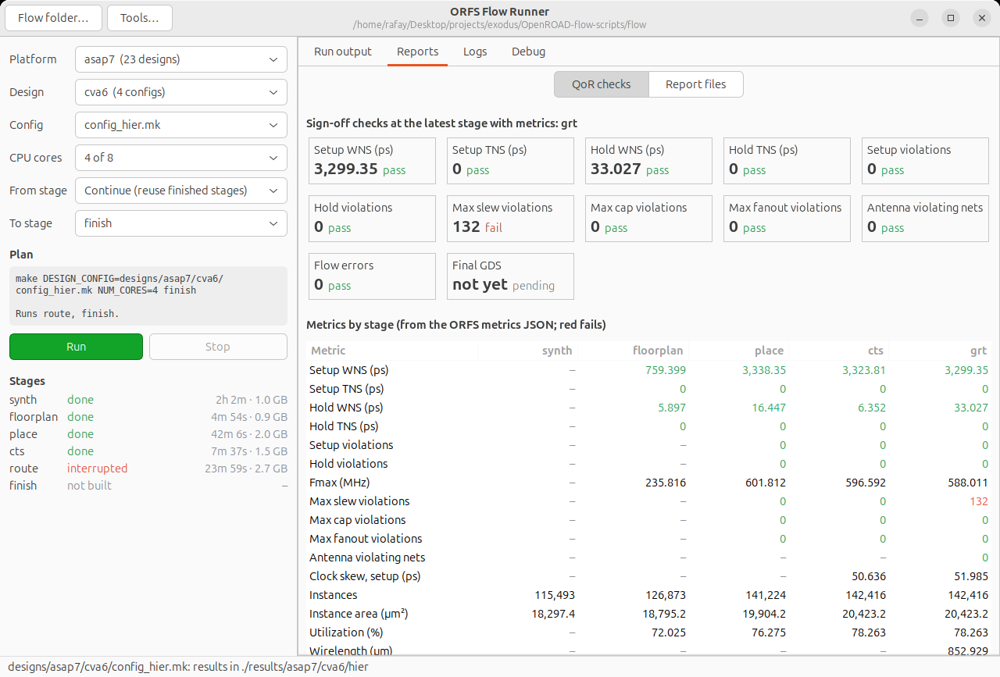
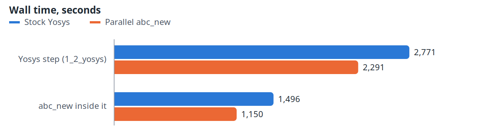

# ORFS Flow Runner

A desktop app that runs any OpenROAD-flow-scripts (ORFS) design from RTL to GDS. You pick the design, CPU cores
and stage range from drop-down menus, press Run, and read the results in separate **Reports**, **Logs** and
**Debug** tabs. It drives the stock ORFS Makefile, so a run here gives the same result as the same `make` command
in a terminal.


The illustrated user guide, [docs/ORFS_Flow_Runner_user_guide.pdf](../docs/ORFS_Flow_Runner_user_guide.pdf), walks
through every part of the app with screenshots from real CVA6 runs, including a stock against parallel `abc_new`
comparison ([A/B synthesis run](#ab-synthesis-run-stock-and-parallel-abc_new) below).

Contents: [Install](#install) · [Requirements](#requirements) · [Step by step](#step-by-step) · [The menus](#the-menus) ·
[The tabs](#the-tabs) · [Common tasks](#common-tasks) · [A/B synthesis run](#ab-synthesis-run-stock-and-parallel-abc_new) ·
[Troubleshooting](#troubleshooting) · [Files](#files)

## Install

The app ships as a Debian package for Ubuntu (and other Debian-based systems). It installs under
`/opt/orfs-flow-runner`, adds **ORFS Flow Runner** to the app menu and adds an `orfs-flow-runner` command.

1. **Build the package** from a checkout of this repo (or take the `.deb` someone built for you):

   ```bash
   gui/packaging/build_deb.sh
   ```

   This writes `dist/orfs-flow-runner_<version>_all.deb`. The version is `VERSION` in `gui/orfs_app.py`.

2. **Install it.** apt also installs GTK, PyGObject, make and KLayout if they are missing:

   ```bash
   sudo apt install ./dist/orfs-flow-runner_1.0.1_all.deb
   ```

3. **Install OpenROAD, Yosys and an ORFS checkout** if you don't have them; the package doesn't include them
   (see [Requirements](#requirements)).

4. **Start ORFS Flow Runner** from the app menu. On the first start it asks for the ORFS `flow/` folder unless it
   finds one in `$ORFS_FLOW` or `~/OpenROAD-flow-scripts/flow`.

5. **Check Debug → Environment.** If openroad, yosys or klayout shows *NOT FOUND*, click **Tools…** in the title
   bar and choose the program. *Automatic* uses the one on `PATH`, else one in `/usr/local/bin`, `/usr/bin`,
   `/opt/openroad/bin` or `~/.local/bin`.

   

To update, build and install the newer `.deb` the same way. To remove it: `sudo apt remove orfs-flow-runner`
(your settings and run logs in your home folder are kept).

If you used `gui/install_launcher.sh` before, run `gui/install_launcher.sh --uninstall` first: its menu entry
has the same name and would hide the installed one.

## Requirements

Tested on Ubuntu 24.04 with these versions:

| Needed | Tested version | How to get it |
| --- | --- | --- |
| Python 3 | 3.12.3 | ships with Ubuntu |
| PyGObject + GTK 3 | `python3-gi` 3.48.2, `gir1.2-gtk-3.0` 3.24.41 | `sudo apt install python3-gi gir1.2-gtk-3.0` (Ubuntu desktops already have them) |
| OpenROAD | `26Q4-271-g0907a8656e` | Step 1 of the [repo README](../README.md#step-1-install-the-tools) |
| Yosys | 0.69+274, with `read_slang` | Step 1 of the repo README; `read_slang` is needed for CVA6 |
| KLayout | 0.28.16 | `sudo apt install klayout`; only the finish stage uses it, to write the GDS |
| ORFS flow folder | `OpenROAD-flow-scripts/flow` | `git clone --recursive https://github.com/The-OpenROAD-Project/OpenROAD-flow-scripts` |

The repo's vendored `orfs/flow` also works, but it only has the asap7 platform and the CVA6 design. The full ORFS
clone has 85 designs on 9 platforms, 71 of them runnable (gf12 and gf55 need PDKs that are not public).

## Step by step

This runs the small `gcd` design on nangate45 (7 min 51 s on 4 cores in testing). CVA6 works the same way; only
the choices and the run time change.

1. **Start the app** from the app menu if you [installed](#install) it, or from the repo root without
   installing:

   ```bash
   python3 gui/orfs_app.py
   ```

   It opens the flow folder you used last, else `$ORFS_FLOW`, else `./OpenROAD-flow-scripts/flow`, else
   `./orfs/flow`, else `~/OpenROAD-flow-scripts/flow`. The title bar shows which one. To pick another, click
   **Flow folder…** or start with `--flow /path/to/OpenROAD-flow-scripts/flow`.

2. **Optional, when running from the checkout: add it to the app menu and the Desktop** without installing the
   package:

   ```bash
   gui/install_launcher.sh
   ```

   `gui/install_launcher.sh --uninstall` removes it. Programs are found as described under **Tools…** in
   [Install](#install).

3. **Platform:** choose `nangate45`. The number after each name is its design count. Platforms marked
   *PDK not installed* can't be selected.

4. **Design:** choose `gcd`.

5. **Config:** choose the `config*.mk` file. `gcd` only has `config.mk`; for CVA6 choose `config_hier.mk`. The
   status bar then shows where results will go, for example `./results/nangate45/gcd/base`.

6. **CPU cores:** choose how many OpenROAD may use, for example `4 of 8`. Fewer cores use less memory; use 4 for
   CVA6 routing on a 16 GB machine.

7. **From stage:** choose *Continue (reuse finished stages)*. To redo work, choose *Re-run from <stage>*
   instead (see [The menus](#the-menus)).

8. **To stage:** choose `finish` to go all the way to GDS.

9. **Read the plan box.** It shows the exact command, here
   `make DESIGN_CONFIG=designs/nangate45/gcd/config.mk NUM_CORES=4 finish`, which stages will run, and anything
   that will be deleted.

10. **Press Run.** The **Run output** tab streams the output (errors red, warnings amber). The **Stages** list
    moves each stage from *not built* to *running* to *done*, with its runtime and peak memory. The status bar
    shows the current step (for example `1_2_yosys`), the tool and memory use.

11. **Wait for `>> exit code 0`.** The status bar then says *Run finished*. A non-zero exit code means a step
    failed: see [Troubleshooting](#troubleshooting).

12. **Check the results** in **Reports → QoR checks**: timing slack, slew/cap/fanout violations, DRC, antenna and
    whether `6_final.gds` was written. **Debug → Open results folder** opens the folder with the GDS.

To stop a run, press **Stop** and confirm. The running step is killed, its partial log stays as a `.tmp.log`,
and finished stages are kept.

## The menus

| Menu | Lists | Sets |
| --- | --- | --- |
| Platform | each folder in `flow/designs/` with designs; greyed out without `flow/platforms/<name>/config.mk` | the PDK |
| Design | that platform's designs | the design folder |
| Config | the design's `config*.mk` files | `DESIGN_CONFIG`, and with it the results folder |
| CPU cores | 1 to the number of cores | `NUM_CORES` |
| From stage | *Continue*, or *Re-run from* synth, floorplan, place, cts, route, finish | what is cleaned first |
| To stage | synth, floorplan, place, cts, route, finish | the last `make` target |

- **Continue** runs `make <to-stage>`; make reuses every stage that is already built.
- **Re-run from X** runs `make clean_X` for X and every later stage, then `make <to-stage>`. Later stages are
  cleaned too because they were built from the old X. You are asked to confirm, with the list of stages that will
  be deleted (partial ones included).
- If **From** comes after **To**, Run stays disabled. If a stage before **From** was never built, make builds it
  first, and the plan says so.

The app remembers your choices for the next start.

## The tabs



- **Run output:** live output of the current run.
- **Reports:**
  - *QoR checks*: pass/fail tiles at the latest stage with metrics (setup/hold WNS and TNS, setup/hold
    violations, max slew/cap/fanout, antenna, flow errors, DRC report, final GDS), then a table of every metric
    by stage (synth, floorplan, place, cts, grt, route, final). Red fails: negative slack or a non-zero count. The
    numbers come from the ORFS metrics JSON in `logs/<platform>/<design>/<variant>/`.
  - *Report files*: the design's `reports/` folder, with a line filter and an errors-and-warnings-only view.
- **Logs:** stage logs (`logs/…`, one per step; `.tmp.log` = running or killed) and run logs (`~/.local/share/orfs-flow-runner/run_logs/`,
  one per run, newest first). Filter lines, show only errors and warnings, or tick **Follow** to watch a log being written.
- **Debug:**
  - *Actions*: **Dry run (make -n)**, **Open in OpenROAD GUI** for a built stage (needs a display), **Open
    results folder**, **Copy command** (to run the plan in a terminal).
  - *Environment*: flow folder, openroad/yosys/klayout versions and paths, whether Yosys has `read_slang`, CPU
    count, free memory, run-log folder, flow git commit.
  - *Resolved make variables*: `PLATFORM`, `DESIGN_NICKNAME`, `FLOW_VARIANT`, `RESULTS_DIR`, `SDC_FILE`,
    `CORE_UTILIZATION`, `PLACE_DENSITY`, `VERILOG_FILES` and others, as `make print-<VAR>` reports them.
  - *Errors and warnings*: a count of every message ID (for example `RSZ-0104`) in the design's logs, errors
    first. Double-click one to open its log in **Logs**, filtered to that ID.
  - *Debug output*: dry-run output and messages, at the bottom of the tab.

## Common tasks

**Finish CVA6 from where routing stopped:** Platform `asap7`, Design `cva6`, Config `config_hier.mk`, CPU cores
`4 of 8`, From *Continue*, To `finish`. The plan reads *Runs route, finish.* Detailed routing needs about 7 GB, so
close heavy applications first and check **Debug → Environment → Memory**.

**Re-run placement after changing the config:** edit the design's `config*.mk`, then From *Re-run from place*,
To `place` or later. Synth and floorplan are reused; place and later stages are rebuilt.

**Runs that must survive logging out:** closing the app asks whether to stop its run. Use **Debug → Copy
command** and start it with `systemd-run --user` as in the repo README's
[Running unattended](../README.md#running-unattended). The app still shows that run's results and logs, but not
its live status.

## A/B synthesis run: stock and parallel abc_new

`orfs/flow/designs/asap7/cva6/` has two configs for comparing Yosys builds on CVA6. Both include `config_hier.mk`
and only change `FLOW_VARIANT`, so their results stay apart:

| Config | Results in | Choose this Yosys in **Tools…** |
| --- | --- | --- |
| `config_hier_stock.mk` | `results/asap7/cva6/hier_stock` | a stock build, for example `/usr/local/bin/yosys` |
| `config_hier_parallel.mk` | `results/asap7/cva6/hier_parallel` | the `yosys/` submodule build, `yosys/build/yosys` |

1. Build Yosys from the submodule ([README, Step 2](../README.md#step-2-clone-this-repo-and-build-yosys)).
2. Platform `asap7`, Design `cva6`, Config `config_hier_stock.mk`, To stage `synth`; set Yosys to the stock build
   in **Tools…** and press **Run**.
3. When it finishes, choose `config_hier_parallel.mk`, set Yosys to `yosys/build/yosys` and press **Run**.
4. Compare the **Stages** times and the end of each variant's `1_2_yosys.log` (`Took … seconds: abc_new` and the
   time per pass).

Measured from the app on an i5-1235U (8 threads, 10 GB), one run each, `NUM_CORES=8`:

| Measure | Stock (0.69+274) | Parallel (0.69+280) |
| --- | --- | --- |
| Whole synthesis | 47 min 55 s | 39 min 9 s |
| `1_2_yosys` step | 2,771 s | 2,291 s |
| `abc_new` inside it | 1,496 s | 1,150 s |
| Peak memory | 1.0 GB | 1.0 GB |
| Netlist | 115,493 instances, 18,297.4 µm² | identical, apart from the Yosys version comment |



At most 4 `yosys-abc` processes ran at once: Yosys's own serial work around each ABC call (`write_xaiger2` alone
takes 467 s) caps the saving. The guide's section 7 has the method and the per-run detail.

## Troubleshooting

| Problem | What to do |
| --- | --- |
| `No module named gi` at start | `sudo apt install python3-gi gir1.2-gtk-3.0`, and use the system `python3`, not a venv |
| A run fails at once with error 127 | OpenROAD or Yosys wasn't found: check **Debug → Environment** and choose the program with **Tools…** |
| The Platform menu is empty | the folder isn't an ORFS `flow/` folder: use **Flow folder…** |
| A stage shows *interrupted* | the step was killed, usually for lack of memory. Look for `oomd` or `oom-kill` in `journalctl --since "1 hour ago"`, use fewer cores, then run again with *Continue* |
| `read_slang` not found (CVA6) | **Debug** shows *read_slang missing*: build Yosys with the slang frontend (repo README, Step 1) |
| Make variables show *make error* | the config doesn't parse; the message is in **Debug output** |
| Open in OpenROAD GUI does nothing | it needs a display; see `~/.cache/orfs-flow-runner/openroad_gui.log` |

Limits: one run at a time per window; only runs started from the app show as *running*; viewers show the last
4 MB of a log (the full output is always in the run log).

## Files

| Path | What it is |
| --- | --- |
| `gui/orfs_app.py` | the app |
| `gui/flow_gui.py` | the CVA6 web console; the app reuses its metric definitions, so keep both together |
| `gui/install_launcher.sh` | adds or removes a menu and Desktop launcher for running from the checkout |
| `gui/packaging/build_deb.sh` | builds the `.deb`; `orfs-flow-runner.desktop` and `.svg` are its menu entry and icon |
| `docs/ORFS_Flow_Runner_user_guide.pdf` | the illustrated user guide; `docs/images/gui/` has the screenshots used in this README |
| `orfs/flow/designs/asap7/cva6/config_hier_{stock,parallel}.mk` | the A/B configs above |
| `~/.config/orfs-flow-runner/settings.json` | last flow folder, menu choices and the programs chosen with **Tools…** |
| `~/.local/share/orfs-flow-runner/run_logs/` | one full log per run: `<platform>_<design>_<variant>_<from>-<to>_<date>_<time>.log` |
| `~/.cache/orfs-flow-runner/` | OpenROAD GUI log; safe to delete |
| `<flow>/results/<platform>/<design>/<variant>/` | ORFS results: one `.odb` per stage, `6_final.gds` |
| `<flow>/logs/…`, `<flow>/reports/…` | ORFS step logs (with metrics JSON) and reports |
| `gui/.cache/` | web-console renders; safe to delete, ignored by git |
